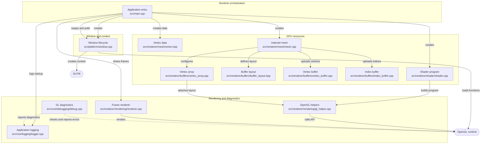

# OpenGL Learning

A C++23 project for learning modern OpenGL. The current application creates an OpenGL 4.5 Core context, loads a GLSL 450 shader program, uploads indexed mesh data, and renders an animated, colored rectangle.

The project is built around small components for window/context management, GPU buffers, vertex layouts, meshes, shaders, rendering, logging, and OpenGL diagnostics.

## Current technology

- **Language:** C++23
- **Graphics API:** OpenGL 4.5 Core Profile
- **Shader language:** GLSL 450 Core
- **Window/context:** GLFW
- **OpenGL function loading:** GLAD 2 (`<glad/gl.h>`)
- **Math:** GLM
- **Build tool:** MinGW-w64 GCC (Windows `build.bat` is provided)

The logger uses C++23 library facilities including `<print>`. Use a recent GCC/libstdc++ toolchain with working C++23 library support; a current MSYS2 UCRT64 toolchain is a practical Windows choice.

## Features currently present

- GLFW window creation and OpenGL context setup.
- GLAD initialization after the context becomes current.
- OpenGL debug-context request and a debug-message callback.
- Shader loading from external vertex and fragment shader files.
- Vertex, index, and vertex-array abstractions.
- A `MeshVertex` structure and a `BufferLayout` that calculates attribute offsets and stride.
- Indexed mesh drawing through a small `Renderer` interface.
- Direct State Access (DSA) calls for buffer and vertex-array configuration where used.
- GLM-based vertex transformation for a simple pulse animation.
- Application logging with levels and optional terminal colors/timestamps.

## Repository layout

```text
opengl-learning/
├── src/
│   ├── main.cpp
│   ├── app/
│   ├── core/
│   │   ├── debugging/
│   │   └── logging/
│   ├── platform/
│   │   └── window.cpp
│   └── renderer/
│       ├── buffers/
│       ├── mesh/
│       ├── rendering/
│       └── shader/
├── shaders/
│   ├── vertex.vert
│   └── fragment.frag
├── tests/
├── build.bat
├── .gitignore
├── LICENSE
└── README.md
```

## Architecture

The diagram below uses the paths in the current repository layout (not the older `core/window.cpp` and flat `renderer.cpp` paths).



### Important implementation detail

The project README and source currently place the window implementation under `src/platform/`, logging under `src/core/logging/`, diagnostics under `src/core/debugging/`, and renderer components in nested folders under `src/renderer/`. Keep diagrams and build scripts aligned with these paths when the project is reorganized.

## Windows setup (MSYS2 UCRT64 + MinGW-w64)

### 1. Install the compiler and available dependencies

Open the **MSYS2 UCRT64** terminal and update/install the toolchain, GLFW, and GLM:

```bash
pacman -Syu
pacman -S --needed mingw-w64-ucrt-x86_64-toolchain mingw-w64-ucrt-x86_64-glfw mingw-w64-ucrt-x86_64-glm
```

If the installer asks you to close the terminal after a core update, close it, reopen the UCRT64 terminal, and run the install command again.

Make sure the UCRT64 compiler directory is available to Windows when you run `build.bat`. With the default MSYS2 installation, this is commonly:

```text
C:\msys64\ucrt64\bin
```

Verify the compiler from PowerShell or Command Prompt:

```powershell
g++ --version
where.exe g++
```

### 2. Provide GLAD 2

The source includes `<glad/gl.h>` and calls `gladLoadGL`. GLAD is not currently vendored in this repository, so provide a GLAD 2 loader generated for the OpenGL API/version used by the project.

**Recommended layout:** place the generated files under `third_party/glad/`:

```text
third_party/
└── glad/
    ├── include/
    │   ├── glad/gl.h
    │   └── KHR/khrplatform.h
    └── src/gl.c
```

`build.bat` automatically detects `third_party/glad/src/gl.c` and compiles it as C. It also adds `third_party/glad/include` to the include search path.

Alternatively, set `GLAD_ROOT` to the root of a generated GLAD directory containing `include/` and `src/gl.c`:

```powershell
$env:GLAD_ROOT = "C:\path\to\generated-glad"
```

If GLAD is already installed as a linkable library and its headers are on the compiler's include path, the script falls back to `-lglad`. You can override linker flags with `GLAD_LIBS`.

### 3. Build and run

From the repository root, run:

```powershell
.\build.bat
```

This compiles the C++ sources under `src/`, creates `bin\opengl-learning.exe`, and runs it. The script launches the executable from the repository root because the application currently loads shaders using relative paths such as `shaders/vertex.vert`.

Other commands:

```powershell
.\build.bat build   # Compile only; do not launch the application
.\build.bat clean   # Remove generated build/ and bin/ directories
```

The build script defaults to these Windows link libraries:

- `-lglfw3` for the MSYS2 UCRT64 GLFW package
- `-lopengl32 -lgdi32` for Windows OpenGL and GDI libraries
- `-lglad` when a generated GLAD C source file is not found

You can override the GLFW flags, for example, if you installed GLFW somewhere else:

```powershell
$env:GLFW_LIBS = '-L"C:\path\to\glfw\lib" -lglfw3'
```

You may also set `GLAD_SOURCE_FILE`, `GLAD_INCLUDE_DIR`, `GLAD_LIBS`, `GLFW_INCLUDE_DIR`, `GLM_INCLUDE_DIR`, `CXX`, and `CC` if your dependency layout or compiler names differ. `CXX` should name the C++ compiler executable (normally `g++`), and `CC` should name the C compiler used for GLAD's `gl.c` (normally `gcc`).

### Runtime notes

- A GPU driver that supports an OpenGL 4.5 Core context is required.
- The build script copies common MSYS2 runtime DLLs next to the executable when they are present beside the selected compiler. If Windows still reports a missing DLL, ensure the matching MSYS2 UCRT64 `bin` directory is on `PATH`.
- Shader compilation/linking errors are reported by the application's OpenGL helper/logging code. Check the terminal output.

## Running on Linux

The current repository's original Linux-style command is:

```bash
g++ -std=c++23 -Wall -Wextra -Wpedantic -O0 -g -DDEBUG \
    -Isrc src/main.cpp src/*/*.cpp src/*/*/*.cpp \
    -lGL -lglfw -lglad -o bin/opengl-learning
```

Adjust include/library paths and library names for the packages installed on your distribution. The Windows `build.bat` is specifically intended for MinGW-w64 on Windows.

## Controls

- **Esc:** close the window.
- **Space:** log a key press/release event.
- **F11:** currently logs a placeholder message; fullscreen switching is not implemented yet.

## Suggested next milestones

1. **Make dependencies reproducible:** add the generated GLAD 2 files under `third_party/glad/` (or document a repeatable generation process), and make sure all required dependency headers are available to a fresh clone.
2. **Add a proper cross-platform build system:** introduce CMake with explicit targets for the application, GLAD, GLFW, and GLM. Keep `build.bat` as a thin wrapper around CMake once that is in place.
3. **Harden window initialization:** make `Window` construction fail explicitly if `glfwInit`, window creation, or GLAD initialization fails. Avoid continuing with an invalid window/context.
4. **Improve shader failure handling:** stop program creation when either shader fails to compile, return a clear failure result, and clean up all intermediate shader objects.
5. **Complete the input layer:** implement the F11 fullscreen behaviour or remove the placeholder until it is supported.
6. **Add a camera and transforms:** introduce model, view, and projection matrices, then render a 3D object instead of only scaling vertex positions on the CPU.
7. **Add textures and material data:** load a texture, create a sampler, and extend the vertex layout/shaders to use UV coordinates.
8. **Test non-GL code and resource ownership:** add tests for CPU-side buffer-layout calculations and other logic that does not require a live graphics context; add focused runtime checks for GL resource lifecycle.

## License

This project is distributed under the MIT License. See [LICENSE](LICENSE).
